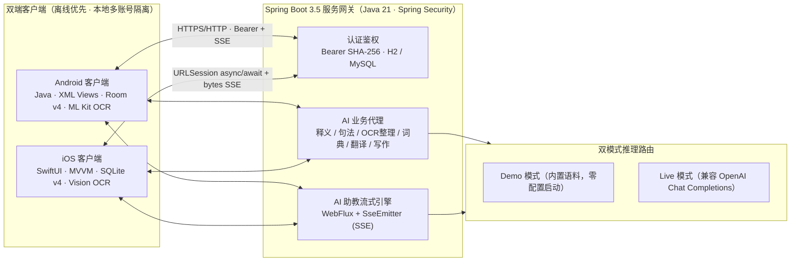

# CetHelper · 四六级 AI 学习助手

[](https://github.com/lixinyao00/cet-ai-helper/actions/workflows/ci.yml)


一款面向大学英语四六级备考的**端云协同 AI 学习系统**，包含 **Spring Boot 后端服务**、**Android 原生客户端**与 **iOS SwiftUI 客户端**。三端共用同一套 `/api/v1` REST + SSE 接口契约、Demo 内置语料与错误码语义，核心学习数据离线优先保存在端侧本地数据库。

---

## 系统架构



---

## 核心功能矩阵

| 模块 | 能力说明 | 核心技术 / 接口 |
| --- | --- | --- |
| **拍照/相册 OCR 导入** | 拍照或相册选图后端侧识别英文/中文段落，经服务端清理分段后入库 | Android ML Kit / iOS Vision + `POST /api/v1/articles/organize` |
| **沉浸阅读与语境点词** | 点击单词或长按同句划词查义，自动还原词形并支持一键收藏回原文定位 | `POST /api/v1/explanations` + UTF-16 偏移高亮 |
| **长难句拆解** | 主干概括 + 按原文顺序拆解从句/短语语法作用 | `POST /api/v1/sentence-analyses` |
| **独立查词与联想** | 前缀联想（支持 CET-4 / CET-6 过滤）、音标/词性/双语例句与查词历史 | `GET /api/v1/dictionary/suggest`、`POST /api/v1/dictionary/lookup` |
| **AI 助教（SSE 流式）** | 自由问答 + 从查词/句法/翻译/写作携带上下文追问，增量输出与推荐追问 | `POST /api/v1/tutor/chat/stream`（`meta` → `delta`×N → `done`） |
| **生词本与原句填空** | 按级别/来源/掌握度三级筛选，结合 SRS 复习间隔生成原句首字母填空 | 本地 SQLite / Room v4 + SRS 调度 |
| **汉译英与写作复测** | 按关键词/短语/结构分步提示，逐字引用定位批改，写作针对性练习与换题复测 | `POST /api/v1/translation-*`、`POST /api/v1/writing-*` |

---

## 工程与技术亮点

- **Demo / Live 双模式与契约校验**：服务端支持 `demo`（零密钥内置语料）与 `live`（Spring AI + 兼容 OpenAI 协议）无缝切换；对模型输出做严格 JSON 与原文引用校验，异常统一脱敏为稳定错误码（`502 MODEL_ERROR` / `504 MODEL_TIMEOUT`）。
- **流式 SSE 助教与上下文会话**：后端基于 `Spring WebFlux` 消费上游流并通过 Servlet `SseEmitter` 透传事件流；双端支持中止生成、状态保留与确定性 `sessionKey` 持久化恢复。
- **端侧多租户隔离与无损迁移**：客户端全部学习数据按 `(serverUrl, studentId)` 复合隔离，切换服务地址或账号互不串库；支持 Room / SQLite `v3 → v4` 无损迁移。
- **离线续用与跨进程草稿恢复**：断网冷启动自动切换离线只读/复习模式，网络恢复自动通过 `/me` 静默复验；`401` 失效安全退回登录态；写作与翻译草稿跨进程强制停止仍可恢复。
- **高覆盖自动化测试体系**：服务端 233 项集成/单测（含 `FakeOpenAiServer` 假上游契约回归）+ Android JVM/Instrumentation/跨进程脚本 + iOS 69 项离线单测、真实服务集成测试与浅/深色 XCUITest E2E（配合代理模拟断网与 401）。

---

## 目录结构

```text
.
├── server/                 # Spring Boot 3.5 + Java 21 后端服务（H2 / MySQL + Spring AI）
├── android/                # Android 原生客户端（Java + XML Views + Room v4 + ML Kit）
├── ios/                    # iOS 原生客户端（SwiftUI + MVVM + SQLite v4 + Vision）
├── docs/                   # 完整 REST/SSE 接口契约与各端历史验证记录
├── .github/workflows/      # GitHub Actions CI（Server + Android + iOS）
└── .env.example            # 环境变量模板（Demo / Live / MySQL）
```

---

## 快速开始（3 分钟本地体验 Demo 模式）

### 1. 启动后端服务（JDK 21）

```sh
cd server
./mvnw -B spring-boot:run
# 默认监听 http://127.0.0.1:8080，mode=demo（无需模型 API Key）
```

> 若需接入真实大模型，参考 [`.env.example`](.env.example) 配置 `CET_EXPLANATION_MODE=live` 与 `CET_MODEL_*` 环境变量；完整说明见 [服务端文档](server/README.md)。

### 2. 运行客户端

- **iOS 模拟器**（macOS + Xcode，推荐直接连接 `http://127.0.0.1:8080`）：
  ```sh
  cd ios
  xcodebuild -project CetHelper.xcodeproj -scheme CetHelper     -destination "platform=iOS Simulator,name=iPhone 17"     -derivedDataPath build CODE_SIGNING_ALLOWED=NO build
  ```
- **Android 真机 / 模拟器**（JDK 17/21 + Android SDK 35，模拟器默认连接 `http://10.0.2.2:8080`）：
  ```sh
  cd android
  ./gradlew :app:testDebugUnitTest :app:assembleDebug
  ```

---

## 各端文档与测试

| 文档 | 内容 |
| --- | --- |
| [服务端 README](server/README.md) | 后端架构、Demo/Live/MySQL 启动方式、安全设计与测试（233 tests） |
| [Android README](android/README.md) | 构建安装、真机 USB 联调、Room v4 与离线/草稿机制 |
| [iOS README](ios/README.md) | Xcode 构建、SQLite v4 架构、单测 / 集成 / XCUITest 全量说明 |
| [API 契约文档](docs/api-contract.md) | `/api/v1/*` 全部接口入参/出参、错误码表与 `curl` 联调示例 |
| [测试脚本与验收记录](docs/verification-notes.md) | `live_smoke.py`、`draft_process_qa.py`、`e2e_proxy.py` 及里程碑实测记录 |
